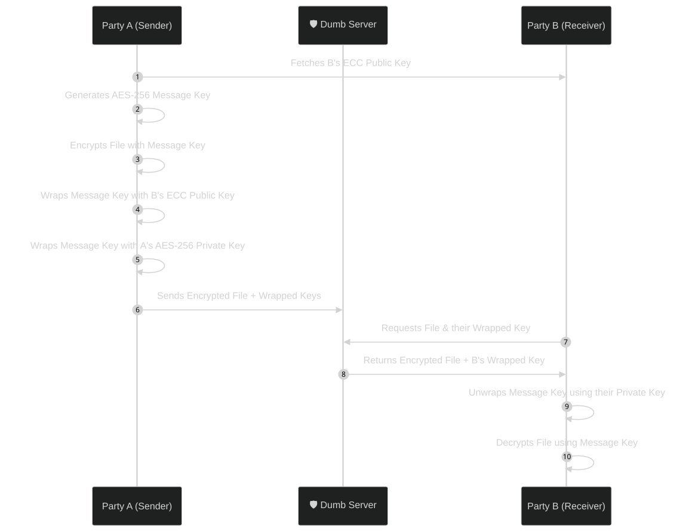

# 🏰 HOSN Engine
## 1-to-1 End-to-End Encryption (E2EE)
**Zero-Knowledge Privacy with Content Recovery**

---

## 🎯 The Concept

**HOSN** is a security pattern within the SYCORE Framework designed to provide absolute **End-to-End Encryption (E2EE)** for direct (1-to-1) communication.

**Key Features:**
- Absolute secrecy between the two parties.
- The Server (Dumb Server) cannot decrypt or read *any* content.
- Ensures **Content Recovery**: the sender can still access their sent history.

---

## 📊 Sequence Diagram: HOSN Flow

  

---

## 🔑 Step 1: Key Exchange

Every user (party) generates and owns a set of cryptographic keys locally on their device:
- **AES-256 Private Key** (Derived from user's password)
- **AES-256 Public Key** (Rotated periodically)
- **ECC Private Key** (X25519 - Rotated periodically)
- **ECC Public Key** (X25519 - Rotated periodically)

*The server only stores the Public Keys to facilitate exchange.*

---

## 📤 Step 2: Sending Content

When Party A wants to send a file to Party B:
1. Party A fetches Party B's **ECC Public Key**.
2. Party A generates a fresh, random **AES-256 Message Key** for this specific file.
3. The file is encrypted using this Message Key, creating a **single blind ciphertext**.
4. Party A **wraps (encrypts)** the Message Key twice:
   - Once using B's ECC Public Key (so B can read it).
   - Once using A's AES-256 Private Key (so A can recover their sent file).
5. Party A sends to the server: The encrypted file + Wrapped Key for A + Wrapped Key for B.

---

## 📥 Step 3: Receiving & Decrypting

When Party B receives the file:
1. Party B fetches the encrypted file and **their specific wrapped key** from the server.
2. Party B **unwraps** the Message Key using their own Private Key.
3. Party B uses the unwrapped **Message Key** to finally decrypt the file.

---

## 🗄️ Storage & Security Notes
**Stored on the Server:**
- Only **ONE** copy of the encrypted file/message (Blind BLOB).
- A list of the wrapped keys for the involved parties.
**Security Constraints:**
- The server has absolutely **zero ability** to decrypt any content.
- Key rotation requires verification that new keys are stable before dropping old ones.
- Decryption keys are attached to the content header or sent as isolated messages.
- Edge cases (offline availability, multi-device, password changes) must be handled gracefully by the SDK.

---

## ✅ Summary

HOSN guarantees absolute confidentiality of content between two parties. It natively solves the problem of "sender history recovery" while completely preventing the server from accessing sensitive data or keys.
