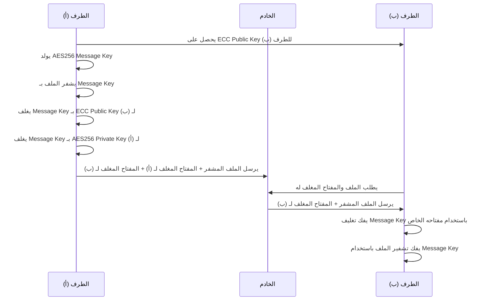

# مخطط تدفق HOSN

# HOSN: تشفير الند للند واستعادة المحتوى

## المفهوم

HOSN هو نمط أمان يهدف لتوفير تشفير ند-لند (End-to-End) مع إمكانية استعادة والوصول للمحتوى القديم بين الأطراف، بحيث لا يستطيع الخادم (Server) فك تشفير أي محتوى أو معرفة محتواه.

## خطوات العمل

1. **تبادل المفاتيح:**
	- كل طرف (مستخدم) يملك مفاتيح خاصة وعامة:
	  - AES256 Private Key (مشتق من كلمة السر)
	  - AES256 Public Key (يتم تغييره دورياً)
	  - ECC Private Key (يتم تغييره دورياً)
	  - ECC Public Key (يتم تغييره دورياً)

2. **إرسال المحتوى:**
	- عند رغبة الطرف (أ) في إرسال محتوى للطرف (ب):
	  1. يحصل (أ) على المفتاح العام ECC للطرف (ب).
	  2. يولد (أ) مفتاح عشوائي جديد (AES256 Message Key) لتشفير الرسالة أو الملف.
	  3. يُشفّر المحتوى بهذا المفتاح (Message Key)، فينتج ملف مشفر واحد فقط.
	  4. يقوم (أ) بتغليف (تشفير) Message Key مرتين:
		  - مرة باستخدام ECC Public Key للطرف (ب) (ليتمكن (ب) من فك التشفير).
		  - مرة باستخدام AES256 Private Key الخاص به (ليتمكن (أ) من استعادة الملف لاحقاً).
	  5. يرسل (أ) إلى الخادم:
		  - الملف/الرسالة المشفرة.
		  - المفتاح المغلف لـ (أ).
		  - المفتاح المغلف لـ (ب).

3. **استلام وفك التشفير:**
	- عند استلام (ب) للملف:
	  1. يحصل على المفتاح المغلف الخاص به ويفك تشفيره باستخدام مفتاحه الخاص.
	  2. يستخدم Message Key لفك تشفير الملف.

## ما يتم تخزينه على الخادم
- نسخة واحدة من الملف/الرسالة المشفرة.
- قائمة بالمفاتيح المغلفة (لكل طرف معني).

## ملاحظات أمنية
- لا يستطيع الخادم فك تشفير أي محتوى.
- عند تغيير المفاتيح، يجب التأكد من استقرار المفاتيح الجديدة قبل حذف القديمة.
- يتم دمج مفتاح فك التشفير في رأس المحتوى أو إرساله كرسالة منفصلة.
- يجب معالجة حالات فقد الاتصال أو تعدد الأجهزة أو تغيير كلمة السر بعناية.

## ملخص
HOSN يضمن سرية تامة للمحتوى بين الأطراف، مع إمكانية استعادة الملفات القديمة، ويمنع الخادم من الوصول لأي بيانات حساسة أو مفاتيح.
