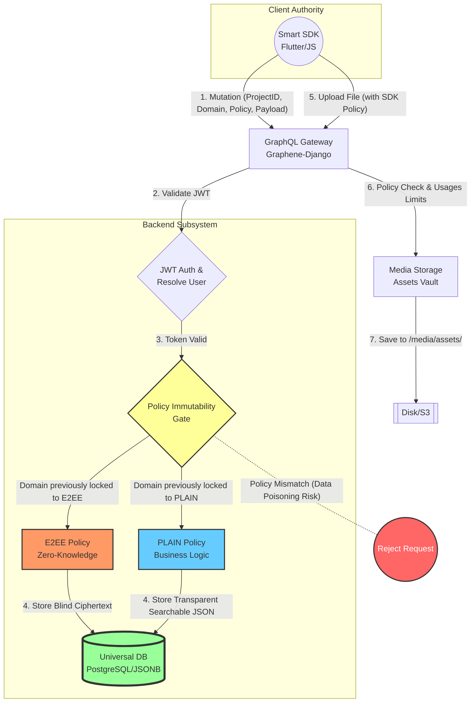

# SYCORE Data Flow Diagram (SY-2139 Protocol v2.0)

This document illustrates how data flows through the SYCORE Framework under the **Zero-Trust BaaS** architecture. It highlights the "Smart SDK, Dumb Server" paradigm, ensuring strict isolation between apps (Multi-Tenancy) and enforcing undeniable security policies (Immutability).

## Description of the Flow

1.  **Initiation (1):** The client application sends a GraphQL request (e.g., `createResource`). If the domain is `HOSN`, the SDK encrypts the data locally before transmission using X25519.
2.  **Authentication Gate (2 & 3):** The JWT Token is validated, identifying the `request.user`. Unauthorized requests are rejected immediately.
3.  **Domain Routing (DomainGate):** The request is routed based on the `domain` field.
    *   **HOSN:** Data is stored as an encrypted blob (Blind Storage). The backend cannot read the content.
    *   **SAMAM:** Data is stored as searchable JSON for business processing.
4.  **Universal Storage:** All resources are saved in the `UniversalResource` table, strictly linked to the `owner_id` to prevent data leakage.
5.  **Asset Management (5, 6, 7):** File uploads check user-specific limits (SY-2139 Limits) before saving to the unified asset storage.

## Updated Flow

The diagram and description have been updated to reflect that the server does **not** have fixed domain names, but instead has a **Policy Immutability Gate** that routes data based on the encrypted or plain pattern requested by the SDK!
