# 🌊 SYCORE Data Flow
## SY-2139 Protocol Architecture
**The "Smart SDK, Dumb Server" Paradigm**

---

## 🏗️ The Core Paradigm

This presentation provides a detailed view of how data moves from the User (Client Application) through the SYCORE SDK, across the network, and into the Server's persistence layer in our **Zero-Trust BaaS**.

We divide the data flow into **5 distinct phases**.

---

## 🔑 Phase 1: Identity & Key Synchronization

**Before any data moves, identity must be established.**

- The **SYCORE SDK** authenticates the user with the backend API.
- The server returns a JWT Token.
- If the user invokes `HOSN` (1-to-1) or `SAMAM` (Team), the SDK first queries the backend for the recipient's **Public Keys** (`ecc_public_key`).
- **Result:** The SDK holds the necessary keys locally to begin the secure payload preparation.

---

## 🧠 Phase 2: Client-Side Preparation (Smart SDK)

**The Flutter app says: *"Save this data to this Domain."* The SDK takes over:**

- **If `E2EE` Clearance (HOSN):** The SDK generates a random symmetric Message Key, encrypts the payload (Blind Ciphertext), and *wraps* the Message Key using the recipient's Public Key.
- **If `PLAIN` Clearance:** The SDK simply structures the JSON.
- **If `JAHR` Clearance:** The SDK takes the plain data, hashes it, and signs it using the user's `Ed25519` private key.

*The server hasn't been contacted yet.*

---

## 🛡️ Phase 3: Policy Immutability Gate (TOFU)

**The payload reaches the Django API. The Backend acts as a Gatekeeper:**

- The Backend asks: *"Has this Project seen this Domain before?"*
- **If No (Trust on First Use):** It creates a new `DomainPolicy` and dynamically locks the domain to the requested clearance (`E2EE` or `PLAIN`).
- **If Yes:** It verifies the incoming clearance against the locked policy.
- **🚨 Data Poisoning Alert:** If an attacker sends `PLAIN` data to an `E2EE` domain, the backend instantly rejects the request.

---

## 🗄️ Phase 4 & 5: Universal Storage & Real-Time

**Persistence and Broadcast:**

- **Phase 4 (Storage):** Once past the gate, the data is dumped blindly into the `UniversalResource` table. No complex relational migrations. The row is strictly scoped to the `owner_id` and `project_id`.
- **Phase 5 (Real-Time Synergy):** Instantly upon save, Django Channels (`async_to_sync`) broadcasts the raw row data over WebSockets to authenticated devices. 
- The receiving SDK unwraps the keys and decrypts the data transparently to the user interface.

---

## 📊 Flow Diagram: The Developer's Choice to TOFU

